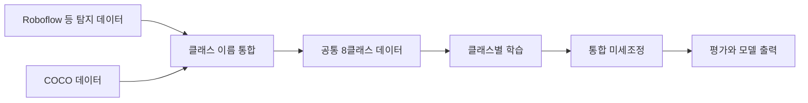

# SafeWalk Project · LEVEL 5 - Expert

<details>
<summary><strong>다른 읽기 수준 선택</strong></summary>

| 읽기 수준 | 설명의 초점 |
| --- | --- |
| [LEVEL 1 · Beginner](%EB%A0%88%EB%B2%A81.md) | 목적과 동작부터 |
| [LEVEL 2 · Explorer](%EB%A0%88%EB%B2%A82.md) | 구성과 연결 원리 |
| [LEVEL 3 · Practitioner](%EB%A0%88%EB%B2%A83.md) | 준비·실행·결과 확인 |
| [LEVEL 4 · Advanced](%EB%A0%88%EB%B2%A84.md) | 구현·설계·실패 처리 |
| [LEVEL 5 · Expert](%EB%A0%88%EB%B2%A85.md) **현재** | 근거·프로토콜·한계 검토 |

</details>

[같은 수준의 프로필](https://github.com/PUVKID/PUVKID/blob/main/docs/읽기안내/레벨5.md) · [프로젝트 첫 화면](../../README.md)

<a id="level-5--프로젝트-소개와-읽는-방법"></a>

## 프로젝트 소개와 읽는 방법

전문 검토는 노트북의 실제 매핑·분할·학습·추론·export 분 기와 실행별 args.yaml/results.csv를 직접 대조합니다. 목표·설정·측정·보행 위험 경고를 구분하며 모델 선택에 노출된 시험 결과를 독립 성능으로 보고하지 않습니다.

<a id="level-5--실제-기능과-동작-범위"></a>

## 실제 기능과 동작 범위


| 대상·조건 | 동작과 의미 |
| --- | --- |
| **상자 라벨 형식** | bbox 5 항목과 세그멘테이션 제외, 클래스 이름 전부 불일치 시 정렬 ID fallback, 선택에 쓰인 시험, 추론·속도·TensorRT의 별도 조건을 원문 셀에서 대조합니다. |


**기능별 공통 근거**

| 대상·조건 | 동작과 의미 |
| --- | --- |
| **탐지와 해석 범위** | 보행환경의 여러 객체를 하나의 분류 체계로 묶어 탐지 모델을 학습하는 프로젝트입니다. |
| **YOLO 탐지 경로** | SafeWalk는 보행 환경을 구성하는 여덟 종류의 객체를 YOLO로 탐지하기 위한 학습 노트북입니다. |
| **실제 기능과 동작 범위** | Roboflow와 COCO 등 서로 다른 데이터의 클래스 표기를 공통 ID로 바꿔 통합하는 부분을 포함합니다. |


| 기능 | 구현 내용 |
| --- | --- |
| 데이터 준비 | 여러 탐지 데이터셋의 다운로드·정리 |
| 클래스 통합 | 원본 라벨 이름을 공통 8 클래스 ID에 매핑 |
| 학습 단계 | 클래스별 학습과 통합 미세조정 구성 |
| 장치 설정 | GPU 확인 및 메모리에 따른 배치 크기 선택 |
| 결과 확인 | 학습 기록·그래프·모델 출력 |
| 변환 경로 | 노트북의 추론·내보내기 실험 구성 |
| 영상 데모 | `SafeWalkDetector`의 웹캠·동영상·이미지 폴더 추론 |



<a id="level-5--입력에서-처리와-출력까지"></a>

## 입력에서 처리와 출력까지

| 자료·처리 경계 | 입력과 출력의 관계 |
| --- | --- |
| **자료 분할** | 볼라드·횡단보도 각각 min(100,15%) 선 배정 뒤 잔여 74%/21%/나머지 분할을 적용합니다. |
| **실행 조건** | 실제 실행 args.yaml·CSV와 split =test 호출, conf·IoU·해상도·max_det·export 장치 조건을 추적합니다. |


| 단계 | 이 프로젝트에서 다루는 내용 |
| --- | --- |
| 입력 | Roboflow·COCO 등 객체 영상과 라벨 |
| 처리 | 클래스 ID 통합, YOLOv8x 클래스별 학습과 전체 미세조정 |
| 출력 | 8 클래스 탐지·평가·영상 데모 |

---

<a id="level-5--사용실험-순서와-확인-방법"></a>

## 사용·실험 순서와 확인 방법

| 확인 단계 | 할 일과 확인 조건 |
| --- | --- |
| **학습 단계별 조건** | Phase 1 YOLOv8x·640·AdamW·15~40 epoch, Phase 2 150 epoch·lr0 =0.0005·patience =0 을 실제 args와 대조합니다. |
| **추론 입력·출력** | 추론 conf 0.4·IoU 0.45·640·max_det 50, 준비 10회/속도 반복 100회 및 FP16 export는 별도 실행 계약으로 검토합니다. |


<a id="level-5--결과와-한계를-해석하는-기준"></a>

## 결과와 한계를 해석하는 기준

| 관측·조건 | 값과 해석 범위 |
| --- | --- |
| **실행·저장 경로** | 현재 경로의 mAP·precision·recall은 선택 영향이 포함된 평가입니다. |
| **속도 측정 조건** | 단일 이미지 반복 속도·CUDA FP16 export·웹 캠 표시 성공과 실제 보행 안전 성능을 구분하며 미측정 값을 만들어 채우지 않습니다. |


<a id="level-5--구현과-핵심-파일을-연결해-읽기"></a>

## 구현과 핵심 파일을 연결해 읽기

| 구성·역할 | 처리와 확인점 |
| --- | --- |
| **노트북 역할** | 전체 노트북 차이와 configs·args.yaml·results.csv, SafeWalkDetector 추론·TensorRT export 코드를 대조합니다. |
| **시험과 모델 선택** | 실제 장치·시험 자료·평가 노출이 기록되지 않은 결과를 코드 목표만으로 확정하지 않습니다. |


<a id="level-5--용어와-실수하기-쉬운-구분"></a>

## 용어와 실수하기 쉬운 구분

| 용어·구분 | 뜻과 적용 범위 |
| --- | --- |
| **탐지와 해석 범위** | 객체 탐지는 사진에서 물체의 종류와 위치를 찾는 일입니다. |
| **정답·평가 근거** | 클래스는 물체 종류, 라벨은 정답 표기, bbox는 물체를 둘러싼 상자 좌표입니다. |
| **YOLO 탐지 경로** | YOLO는 이 탐지에 쓰는 모델 계열입니다. |
| **학습 경로·범위** | 학습은 정답으로 모델을 조정하고 검증·시험은 별도 자료로 결과를 살펴보는 단계입니다. |
| **학습 반복 설정** | epoch는 학습 자료를 한 차례 도는 단위이고 CUDA는 GPU 계산 환경입니다. |
| **탐지와 해석 범위** | **물체 탐지와 실제 보행 위험 판정 성능은 다릅니다.** 시험 결과로 다음 시작 모델을 고르는 구성이라 같은 시험의 최종 수치를 독립 평가로 보지 않습니다. |
| **원본 보존·출처** | 원본 분할을 합쳐 재분할하고 내용 중복 검출이 없으며 이름 매핑 실패 시 ID 정렬 fallback을 확인해야 합니다. |


<a id="level-5--전체-차수와-같은-수준의-상세-설명"></a>

## 전체 차수와 같은 수준의 상세 설명

차수 이름은 실제 보관 단위를 따릅니다. 부분본·시험 도구·최종 안내는 제품 버전과 구분하며, 폴더와 직전 비교를 함께 연결합니다.

| 차수·자료 | 자료 폴더 | 이 수준의 차수 설명 | 직전 비교·범위 |
| --- | --- | --- | --- |
| 기본 노트북 | [자료](../materials/001-step-1) | [LEVEL 5 - Expert](../materials/001-step-1/README.md#reading-level-5) | [전체 비교](../revisions/step-1.patch) |
| 실험 구성과 기록 | [자료](../../pbl2-main) | [LEVEL 5 - Expert](../revisions/step-2.md#reading-level-5) | [전체 비교](../revisions/step-2.patch) |

<a id="level-5--논문원고와-원본-자료의-범위"></a>

## 논문·원고와 원본 자료의 범위

| 대상·조건 | 동작과 의미 |
| --- | --- |
| **공개 구현 자료** | 현재 공개 안내는 노트북·YAML 설정·학습 기록·추론 코드를 다룹니다. |
| **성능 주장 제한** | 모델 이름이나 목표 수치만으로 논문 성과·보행 안전 성능을 만들지 않습니다. |
| **실행 자료·이용 조건** | 각 실행의 실제 설정과 기록, 원본 데이터 이용 조건을 확인합니다. |


<a id="level-5--원래-모든-세부-설명으로-이동하기"></a>

## 원래 모든 세부 설명으로 이동하기

설정값·코드 예제·실패 조건·측정 범위·화면과 파일별 안내를 생략하지 않도록 첫 화면의 전체 본문을 아래에 함께 둡니다. 각 항목은 이 페이지의 공통 근거로 바로 이동합니다. 원문에 담긴 이전 차수 조건을 현재 실행 조건으로 자동 적용하지 않습니다.

| 첫 화면의 원래 항목 | 이 페이지의 전체 근거 |
| --- | --- |
| SafeWalk Project | [원문 보기](#source-section-1) |
| 노트북 셀과 실험 기록의 연결 | [원문 보기](#source-section-2) |
| 차수와 자료 둘러보기 | [원문 보기](#source-section-3) |
| 제가 구현한 부분 | [원문 보기](#source-section-4) |
| 주요 개발 내용 | [원문 보기](#source-section-5) |
| 입력·처리·출력 | [원문 보기](#source-section-6) |
| 프로젝트 소개 | [원문 보기](#source-section-7) |
| 저장소 구성 | [원문 보기](#source-section-8) |
| 주요 기술 | [원문 보기](#source-section-9) |
| 빠른 시작 | [원문 보기](#source-section-10) |
| 데이터 구성과 클래스 | [원문 보기](#source-section-11) |
| 실제 학습 설정 | [원문 보기](#source-section-12) |
| 문제 해결 | [원문 보기](#source-section-13) |

<a id="level-5--항목별-자세한-풀이와-확인-지점"></a>

## 항목별 자세한 풀이와 확인 지점


<a id="level-5--노트북-셀과-실험-기록의-연결"></a>

### 노트북 셀과 실험 기록의 연결


YOLOv8x·Phase1/2·split =test·추론 conf/IoU·속도 반복·export 분기를 실제 셀과 대조합니다.

[이 항목의 전체 조건·원문](#source-section-2)

<a id="level-5--차수와-자료-둘러보기"></a>

### 차수와 자료 둘러보기


원본/현재/이전 도커 버전·설정·CSV 대응과 전체 diff를 검토합니다.

[이 항목의 전체 조건·원문](#source-section-3)

<a id="level-5--제가-구현한-부분"></a>

### 제가 구현한 부분


공개 소스·실행 자료와 서술이 대응하는지 검토하고 안전 성과를 확장하지 않습니다.

[이 항목의 전체 조건·원문](#source-section-4)

<a id="level-5--주요-개발-내용"></a>

### 주요 개발 내용


목표 수치·mAP·모델 선택 조건과 실제 보행 안전 검증을 구분합니다.

[이 항목의 전체 조건·원문](#source-section-5)

<a id="level-5--입력처리출력"></a>

### 입력·처리·출력


bbox 형식·재분할·학습·평가·export 출력 계약을 대조합니다.

[이 항목의 전체 조건·원문](#source-section-6)

<a id="level-5--프로젝트-소개"></a>

### 프로젝트 소개


데이터 준비·GPU 설정·모델 학습·추론·내보내기의 실제 수록 범위를 검토합니다.

[이 항목의 전체 조건·원문](#source-section-7)

<a id="level-5--저장소-구성"></a>

### 저장소 구성


전체 파일 비교·노트북 셀·설정·결과 원값의 귀속을 대조합니다.

[이 항목의 전체 조건·원문](#source-section-8)

<a id="level-5--주요-기술"></a>

### 주요 기술


Ultralytics/PyTorch/OpenCV/Roboflow/pandas/Matplotlib/PyYAML의 실제 셀 의존성과 환경 차이를 대조합니다.

[이 항목의 전체 조건·원문](#source-section-9)

<a id="level-5--빠른-시작"></a>

### 빠른 시작

| 확인 단계 | 할 일과 확인 조건 |
| --- | --- |
| **API 요청·실패** | `ROBOFLOW_API_KEY` 접근권한·데이터셋 고정 버전·`PROJECT_ROOT`·원래 `/root/pbl2-main` 참조를 실제 실행 환경과 대조합니다. |
| **원본 보존·출처** | `merged/processed/per_class` 재생성의 삭제 범위와 원본 보존을 확인하고 COCO 분기 `fiftyone.zoo`의 별도 의존성을 준비합니다. |
| **CUDA 실행 환경** | Linux CUDA 경로 수정 셀과 headless OpenCV의 GUI 부재 때문에 다운로드·학습·웹 캠 표시의 재현 가능성을 각각 판정해야 합니다. |


[이 항목의 전체 조건·원문](#source-section-10)

<a id="level-5--데이터-구성과-클래스"></a>

### 데이터 구성과 클래스

| 대상·조건 | 동작과 의미 |
| --- | --- |
| **이름·ID 매핑** | 공통 ID 0~7과 bicycle·kickboard·bollard·car·motorcycle·stairs·crosswalk·people의 대응을 고정하고 데이터셋별 `class_map`·정렬 ID fallback의 실제 실행 여부를 대조합니다. |
| **상자 라벨 형식** | bbox 5 항목만 수용하고 세그멘테이션을 제외하는 파서 계약, 원본 train/valid/test 통합 후 재분할, 내용 중복 탐지 부재를 평가 프로토콜에 명시해야 합니다. |
| **내용 중복·선언** | 번호 연결 성공을 라벨 의미 검증이나 중복 제거 성공으로 대신하지 않습니다. |


[이 항목의 전체 조건·원문](#source-section-11)

<a id="level-5--실제-학습-설정"></a>

### 실제 학습 설정

| 대상·조건 | 동작과 의미 |
| --- | --- |
| **시험 선배정** | 강제 시험 `min(100, 15%)`의 클래스별 분모와 잔여 74/21/나머지 분할을 재계산하고 Phase 1 시험에 기반한 Phase 2 초기화 선택의 평가 재사용을 명시합니다. |
| **학습 단계별 조건** | Phase 1 YOLOv8x·640·AdamW·15~40 epoch, Phase 2 150 epoch·`lr0=0.0005`·`patience=0`을 실제 `args.yaml`과 `results.csv`에 결합해 지표를 해석합니다. |
| **추론 입력·출력** | conf 0.4·IoU 0.45·640·max_det 50은 추론/상자 후처리 조건, 무작위 한 장 준비 10회/100회 반복은 장치별 속도 측정 조건입니다. |
| **탐지 지표** | 이 계약의 통과와 mAP50·mAP50 –95·precision·recall은 실제 보행 위험 예측·거리 추정·충돌 확률 검증을 대신하지 않습니다. |


[이 항목의 전체 조건·원문](#source-section-12)

<a id="level-5--문제-해결"></a>

### 문제 해결

| 대상·조건 | 동작과 의미 |
| --- | --- |
| **제공 자료 범위** | 자료 수신의 키/권한/버전, GPU 배치 예산, 라벨 매핑, COCO `fiftyone` 의존성과 다운로드 로그, headless OpenCV·GUI·Linux CUDA 경로를 독립 재현 조건으로 대조합니다. |
| **영상 입력·출력** | 영상 한글 표시는 `cv2.putText` Hershey 글꼴과 Matplotlib 설정을 구분합니다. |
| **자료 분할** | 목표값 미달 원인은 분포·분할·로그에 근거해 판단하며 한 증상만으로 모델 효과를 확정하지 않습니다. |


[이 항목의 전체 조건·원문](#source-section-13)

<a id="level-5--다음에-읽을-곳"></a>

## 다음에 읽을 곳

| 대상·조건 | 동작과 의미 |
| --- | --- |
| **다음에 읽을 곳** | 같은 관점의 [프로필](https://github.com/PUVKID/PUVKID/blob/main/docs/읽기안내/레벨5.md)에서 다른 프로젝트로 이동하거나 위 차수표에서 구현의 변화를 읽습니다. |
| **다음에 읽을 곳** | 다른 깊이가 필요하면 페이지 위의 수준 선택을 이용합니다. |
| **다음에 읽을 곳** | 수치·예제 명령·비교 파일은 아래 전체 근거와 차수별 원문에서 함께 확인합니다. |


<a id="common-source"></a>


<a id="level-5--공통-근거--첫-화면의-원래-전체-설명"></a>

## 공통 근거 · 첫 화면의 원래 전체 설명

<a name="-safewalk-project"></a>


<a id="source-section-1"></a>
## SafeWalk Project

여러 데이터셋을 통합해 보행 환경의 8개 클래스를 탐지합니다.

**기술 분류:** 컴퓨터 비전 › 딥 러닝 객체 검출 › 다중 데이터셋·8 클래스 통합

`Python`
`YOLO`
`Jupyter`

[빠른 시작](#quick-start) · [저장소 구성](#repository-structure) · [클래스 구성](#data-settings)

[핵심 구성](#input-processing-output)

<a name="implementation-details"></a>

<a name="-노트북-셀과-실험-기록의-연결"></a>
<a id="source-section-2"></a>
## 노트북 셀과 실험 기록의 연결

데이터 다운로드→원본 클래스명/ID 매핑→YOLO bbox 병합→분할→클래스별 학습→시작 모델 선택→전체 미세조정→평가/추론/내보내기의 순서입니다.

기본 노트북은 이 흐름의 구현이고 pbl2-main은 설정 YAML·실행 노트북·에폭 CSV를 묶은 실험 자료입니다. 같은 파일명이라도 이전 도커 버전과 현재 노트북을 구분합니다.

클래스는 bicycle·kickboard·bollard·car·motorcycle·stairs·crosswalk·people입니다. bbox 5 항목만 사용하고 세그멘테이션 줄을 제외합니다.

원본 데이터의 train/valid/test를 합쳐 다시 나누며, 내용 중복 탐지 없이 이름 매핑이 전부 불일치하면 정렬 ID fallback을 적용하므로 매핑 출력과 원본 분포를 확인해야 합니다.

볼라드와 횡단보도 각각에 min(100,15%) 테스트를 먼저 배정한 뒤 남은 영상을 74%/21%/잔여로 train/val/test에 나눕니다.

Phase1의 테스트 성적으로 Phase2 시작 모델을 선택하므로 같은 테스트의 최종 수치는 선택과 독립된 평가가 아닙니다. 모델 이름과 목표 값을 보행 안전 성과로 해석하지 않습니다.

Phase1은 YOLOv8x·640·AdamW·클래스별 15~40 epoch, Phase2는 150 epoch·lr0 =0.0005·patience =0을 구성합니다.

각 실제 실행의 args.yaml과 results.csv를 묶어 epoch·precision·recall·mAP50·mAP50 –95를 읽습니다.

추론 conf 0.4·IoU 0.45·640·max_det 50과 10회 준비/100회 속도 반복은 학습 설정·시험 성능과 별개입니다.

COCO 분기는 fiftyone이 필요하고 웹캠 GUI에는 headless OpenCV와 다른 표시 환경이 필요합니다.

병합·분할 셀이 merged/processed/per_class를 다시 만들기 때문에 전용 실험 경로와 이전 결과 보존을 먼저 확인합니다.

위험 문구는 탐지 객체 종류에 따른 안내이며 거리나 충돌 확률을 계산하지 않습니다.

[각 차수의 코드·조건·관측·전체 비교](../REVISION_INDEX.md)


<a name="️-차수와-자료-둘러보기"></a>
<a id="source-section-3"></a>
## 차수와 자료 둘러보기

[**전체 차수·파일별 변화 보기 →**](../REVISION_INDEX.md)

| 차수·자료 | 자료 폴더·원본 | 상세 설명 | 직전 비교·범위 |
| --- | --- | --- | --- |
| 기본 노트북 | [자료 폴더](../materials/001-step-1) · [원본 파일](../../safewalk_train_v8_fixed%20%281%29.ipynb) | [상세 설명](../materials/001-step-1/README.md#reading-level-5) | [전체 비교·범위](../revisions/step-1.patch) |
| 실험 구성과 기록 | [자료 폴더](../../pbl2-main) | [상세 설명](../revisions/step-2.md#reading-level-5) | [전체 비교·범위](../revisions/step-2.patch) |


<a name="overview"></a>

<a name="‍-제가-구현한-부분"></a>
<a id="source-section-4"></a>
## 제가 구현한 부분

보행 환경 8개 클래스의 데이터셋 매핑·통합, YOLO 학습·평가 노트북과 실험 기록을 정리했습니다.

<a name="-주요-개발-내용"></a>
<a id="source-section-5"></a>
## 주요 개발 내용

보행 안전 관련 8개 객체의 학습·평가 노트북과 실행 자료를 보관합니다.

테스트 결과로 시작 모델을 선택하는 구성입니다. 모델 선택과 독립된 성능 평가에는 별도 시험 자료가 필요합니다. 

- YOLO 학습·평가 경로를 담은 노트북입니다. 클래스 객체 검출과 실제 보행 위험 판정 성능을 구분합니다.
- 학습 데이터와 평가 설정을 노트북 셀에서 확인해야 하며, 테스트 결과를 이용한 시작 모델 선택 때문에 같은 시험 수치를 완전히 독립된 평가로 볼 수 없습니다.

**자료별 안내:** [기본](../versions/stage-1.md) · [전체 기록](../VERSIONS.md)

<a name="preview"></a>

<a name="input-processing-output"></a>

<a name="-입력처리출력"></a>
<a id="source-section-6"></a>
## 입력·처리·출력

| 단계 | 이 프로젝트에서 다루는 내용 |
| --- | --- |
| 입력 | Roboflow·COCO 등 객체 영상과 라벨 |
| 처리 | 클래스 ID 통합, YOLOv8x 클래스별 학습과 전체 미세조정 |
| 출력 | 8 클래스 탐지·평가·영상 데모 |


---

<a name="introduction"></a>

<a name="-프로젝트-소개"></a>
<a id="source-section-7"></a>
## 프로젝트 소개

보행환경의 여러 객체를 하나의 분류 체계로 묶어 탐지 모델을 학습하는 프로젝트입니다.

SafeWalk는 보행 환경을 구성하는 여덟 종류의 객체를 YOLO로 탐지하기 위한 학습 노트북입니다. Roboflow와 COCO 등 서로 다른 데이터의 클래스 표기를 공통 ID로 바꿔 통합하는 부분을 포함합니다.

| 기능 | 구현 내용 |
| --- | --- |
| 데이터 준비 | 여러 탐지 데이터셋의 다운로드·정리 |
| 클래스 통합 | 원본 라벨 이름을 공통 8 클래스 ID에 매핑 |
| 학습 단계 | 클래스별 학습과 통합 미세조정 구성 |
| 장치 설정 | GPU 확인 및 메모리에 따른 배치 크기 선택 |
| 결과 확인 | 학습 기록·그래프·모델 출력 |
| 변환 경로 | 노트북의 추론·내보내기 실험 구성 |
| 영상 데모 | `SafeWalkDetector`의 웹캠·동영상·이미지 폴더 추론 |


<a name="repository-structure"></a>

<a name="-저장소-구성"></a>
<a id="source-section-8"></a>
## 저장소 구성

```text
.
├── safewalk_train_v8_fixed (1).ipynb
├── pbl2-main/
│   ├── safewalk_train_v8_fixed (1).ipynb
│   └── safewalk_train_v8_fixed (1)_이전도커버전.ipynb
├── docs/VERSIONS.md
└── CHANGELOG.md
```

- [최상위 학습 노트북](../../safewalk_train_v8_fixed%20%281%29.ipynb).
- [보존된 실험 폴더](../../pbl2-main).
- [버전 기록](../VERSIONS.md).

<a name="-주요-기술"></a>
<a id="source-section-9"></a>
## 주요 기술

데이터를 준비하고 모델을 학습하는 데 Ultralytics YOLO, PyTorch, OpenCV, Roboflow, pandas, Matplotlib, PyYAML을 사용합니다. 노트북의 기본 모델은 YOLOv8x이며, GPU 메모리에 따라 배치 크기를 정하는 분기가 있습니다.

데이터셋별 `class_map`에서 비슷한 이름의 라벨을 공통 클래스로 매핑합니다. 예를 들어 보행자 표기나 계단·횡단보도의 여러 명칭을 통합하므로, 실제 다운로드한 버전의 라벨과 매핑이 일치하는지 확인해야 합니다.

<a name="quick-start"></a>

<a name="-빠른-시작"></a>
<a id="source-section-10"></a>
## 빠른 시작

```powershell
python -m pip install jupyterlab
python -m jupyter lab "safewalk_train_v8_fixed (1).ipynb"
```

1. 자신의 Roboflow 접근정보를 실행 환경의 `ROBOFLOW_API_KEY`에 준비합니다.
2. `PROJECT_ROOT`를 실제 실험 폴더에 맞춥니다. 원래 노트북은 `/root/pbl2-main` 경로를 사용합니다.
3. 패키지 설치·GPU 확인 셀을 읽고 실행 환경에 맞는 구성을 확인합니다.
4. 데이터셋 목록과 버전·이용 조건을 검토한 뒤 데이터 준비부터 실행합니다.
5. 학습 결과와 클래스별 지표를 확인하고 필요한 모델 출력 셀을 실행합니다.

CUDA 라이브러리 경로를 다루는 Linux 전용 셀이 있으므로 Windows 로컬 실행에서는 해당 환경 차이를 확인해야 합니다. 데이터셋과 완성 가중치는 별도로 준비합니다.

COCO 다운로드 분기는 `fiftyone.zoo`를 사용하지만 첫 설치 셀의 목록에는 `fiftyone`이 없습니다.

이 경로를 사용할 때는 별도 의존성을 준비해야 합니다.

데이터 병합·분할 셀은 기존 `merged`, `processed`, `per_class` 하위 결과를 지우고 다시 만드므로, `PROJECT_ROOT`를 전용 실험 폴더로 지정하고 이전 결과를 분리해 두세요.

<a name="data-settings"></a>

<a name="-데이터-구성과-클래스"></a>
<a id="source-section-11"></a>
## 데이터 구성과 클래스

| ID | 클래스 | 의미 |
| --- | --- | --- |
| 0 | `bicycle` | 자전거 |
| 1 | `kickboard` | 킥보드 |
| 2 | `bollard` | 볼라드 |
| 3 | `car` | 자동차 |
| 4 | `motorcycle` | 오토바이 |
| 5 | `stairs` | 계단 |
| 6 | `crosswalk` | 횡단보도 |
| 7 | `people` | 보행자 |

<a name="️-실제-학습-설정"></a>
<a id="source-section-12"></a>
### 실제 학습 설정

**단계:** 병합

**코드 설정:** YOLO bbox의 5개 항목 형식을 유지하고 세그멘테이션 라인을 제외

**단계:** 테스트 확보

**코드 설정:** 볼라드·횡단보도 각각 `min(100, 해당 이미지 수의 15%)`를 우선 배정

**단계:** 나머지 분할

**코드 설정:** 강제 테스트 배정 후 남은 이미지의 74% 학습·21% 검증·나머지 테스트

**단계:** Phase 1

**코드 설정:** 클래스별 15~40 epoch, YOLOv8x, 이미지 640, AdamW

**단계:** Phase 2

**코드 설정:** 선택된 Phase 1 모델을 시작점으로 전체 클래스 150 epoch, `lr0=0.0005`, `patience=0`

**단계:** 최종 평가

**코드 설정:** `split="test"`, mAP50·mAP50-95·precision·recall

**단계:** 추론 설정

**코드 설정:** `conf=0.4`, `iou=0.45`, 이미지 640, 최대 탐지 50개

**단계:** 속도 측정

**코드 설정:** 무작위 이미지 한 장으로 준비 추론 10회 뒤 반복 추론 100회


분할 셀의 제목은 7:2:1이지만 실제 비율은 위의 강제 테스트 배정과 74:21 분할에 따라 달라집니다. 테스트 이미지를 항상 100장 확보하는 것도 아닙니다. 또한 Phase 1의 테스트 평가 값으로 Phase 2 시작 모델을 선택하므로, 같은 테스트셋의 최종 값에는 모델 선택의 영향이 포함됩니다.

데이터 이름 매핑에 일치 항목이 하나도 없을 때는 원본 ID와 대상 ID의 정렬 순서로 연결하는 fallback이 있습니다. 해당 경로가 쓰였는지 출력된 ID 매핑을 확인해야 합니다. 데이터 원본별 train·valid·test는 한데 모아 재분할하며, 이미지 내용의 중복 검출은 이 분할 코드에 없습니다.

`SafeWalkDetector`는 자전거·킥보드·자동차·오토바이 탐지에 주의 문구를 표시합니다. 거리를 계산하거나 충돌 위험을 예측하는 로직은 아닙니다. TensorRT 변환은 CUDA 환경에서 FP16 엔진을 생성하는 별도 단계이며, 속도 비교는 자신이 실행한 장치의 결과를 사용합니다.

노트북에는 목표 정확도와 처리속도를 설정했습니다. 실제 보행 안전을 평가하려면 장치별 처리속도와 클래스별 탐지 성능, 실제 보행 환경의 검증이 필요합니다.

<a name="troubleshooting"></a>

<a name="️-문제-해결"></a>
<a id="source-section-13"></a>
## 문제 해결

| 증상 | 확인할 내용 |
| --- | --- |
| Roboflow 인증 오류 | 본인의 환경변수와 해당 데이터셋 접근 권한 |
| 데이터 다운로드 실패 | 프로젝트·버전의 존재와 다운로드 조건 |
| GPU 메모리 부족 | 모델 크기·배치 크기·장치 메모리 |
| 클래스 수가 다름 | 원본 라벨과 공통 `class_map` 매핑 |
| Linux 명령 실패 | CUDA 경로 수정 셀의 운영체제 전제 |
| COCO 분기를 건너뜀 | `fiftyone` 설치와 다운로드 오류 로그 |
| 웹캠 창을 열 수 없음 | 설치 셀은 `opencv-python-headless`를 사용하므로 GUI 표시용 OpenCV 환경 필요 |
| 영상의 한글 표시가 깨짐 | `cv2.putText`의 기본 Hershey 글꼴은 한글용 Matplotlib 설정과 별개 |
| 목표보다 성능이 낮음 | 클래스 분포·분할·실제 학습 로그를 함께 확인 |

---

<div align="center">

**보행환경의 다양한 객체를 같은 기준으로 학습합니다.**

</div>
