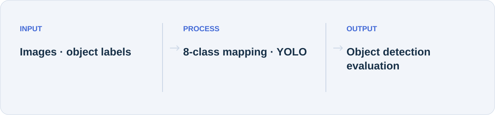
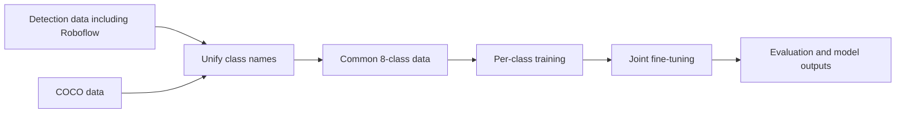

<a name="-safewalk-project"></a>
<!-- readme-header32:start -->
<a name="safewalk-project"></a>
<p align="center"></p>
<h1 align="center" id="project-title">SafeWalk Project</h1>
<p align="center">Detecting and evaluating objects relevant to walking</p>
<p align="center">
  <a href="../README.md"></a>
  <a href="README.md"></a>
</p>
<p align="center">
  <a href="../docs/읽기안내/레벨1.md"></a>
  <a href="../docs/읽기안내/레벨2.md"></a>
  <a href="../docs/읽기안내/레벨3.md"></a>
  <a href="../docs/읽기안내/레벨4.md"></a>
  <a href="../docs/읽기안내/레벨5.md"></a>
</p>
<p align="center"><small>LEVEL links open the Korean source at the same reading level.</small></p>
<picture>
  <source media="(max-width: 600px) and (prefers-color-scheme: dark)" srcset="../assets/readme/flow-en-dark-mobile.svg" />
  <source media="(max-width: 600px)" srcset="../assets/readme/flow-en-light-mobile.svg" />
  <source media="(prefers-color-scheme: dark)" srcset="../assets/readme/flow-en-dark.svg" />
  <source media="(prefers-color-scheme: light)" srcset="../assets/readme/flow-en-light.svg" />
  
</picture>
<!-- readme-header32:end -->


This project combines multiple datasets to detect 8 classes in pedestrian environments.

<!-- project-levels:start -->
## Choose a reading level

| Level | What this guide covers |
| --- | --- |
| [LEVEL 1 - Beginner (Korean source)](../docs/읽기안내/레벨1.md) | Unfamiliar terms, actual behavior, examples, and common misunderstandings. |
| [LEVEL 2 - Explorer (Korean source)](../docs/읽기안내/레벨2.md) | Connections between inputs, processing, outputs, features, and revision changes. |
| [LEVEL 3 - Practitioner (Korean source)](../docs/읽기안내/레벨3.md) | Prerequisites, usage steps, settings, results, and failure checks. |
| [LEVEL 4 - Advanced (Korean source)](../docs/읽기안내/레벨4.md) | Module design, state transitions, validation boundaries, and implementation choices. |
| [LEVEL 5 - Expert (Korean source)](../docs/읽기안내/레벨5.md) | Actual code, protocols, settings, full comparisons, and measurement evidence. |

Every guide covers the same project and all revisions. The existing detailed content is preserved below.
<!-- project-levels:end -->


**Technical field:** Computer vision › Deep-learning object detection › Multiple datasets combined into 8 classes

`Python`
`YOLO`
`Jupyter`

[Quick start](#quick-start) · [Repository structure](#repository-structure) · [Class definitions](#data-settings)

[Core components](#input-processing-output)

<a name="implementation-details"></a>

<a name="-노트북-셀과-실험-기록의-연결"></a>
## How notebook cells connect to experiment records

The sequence is dataset download → original class-name/ID mapping → YOLO bbox merging → splitting → per-class training → starting-model selection → joint fine-tuning → evaluation/inference/export.

The base notebook implements this flow. pbl2-main groups configuration YAML, execution notebooks, and epoch CSV records as experiment materials. Files with the same name may belong to the previous Docker version or the current notebook and should be distinguished.

The classes are bicycle·kickboard·bollard·car·motorcycle·stairs·crosswalk·people. Only the 5-field bbox format is used; segmentation lines are excluded.

Original train/valid/test data are pooled and split again. There is no content-duplicate detection, and a sorted-ID fallback is used if none of the name mappings match. Check the mapping output and original distributions.

For bollards and crosswalks, min(100,15%) is first allocated to testing for each class. Remaining images are split into 74%/21%/remainder for train/val/test.

Phase1 test scores select the Phase2 starting model, so final results on that same test set are not independent of model selection. Model names and target values should not be interpreted as demonstrated pedestrian-safety outcomes.

Phase1 uses YOLOv8x·640·AdamW·15~40 epochs per class. Phase2 is configured for 150 epochs·lr0 =0.0005·patience =0.

Read epoch·precision·recall·mAP50·mAP50–95 together with args.yaml and results.csv from the same actual run.

Inference conf 0.4·IoU 0.45·640·max_det 50 and the 10 warm-up/100 timed repetitions are separate from training settings and test performance.

The COCO branch requires fiftyone, while the webcam GUI requires a display-capable environment different from headless OpenCV.

The merge/split cells recreate merged/processed/per_class. Confirm a dedicated experiment path and preserve previous results first.

Warning messages depend on the type of object detected; they do not calculate distance or collision probability.

[Code, conditions, observations, and full comparisons for every revision (Korean source)](../docs/REVISION_INDEX.md)


<a name="️-차수와-자료-둘러보기"></a>
## Browse revisions and materials

[**All revisions and file changes →** (Korean source)](../docs/REVISION_INDEX.md)

| Revision or material | Folder or original | Details and comparison scope |
| --- | --- | --- |
| Base notebook | [Material folder](../docs/materials/001-step-1) · [Original file](../safewalk_train_v8_fixed%20%281%29.ipynb) | [Details (Korean source)](../docs/materials/001-step-1/README.md)<br>[Full comparison and scope](../docs/revisions/step-1.patch) |
| Experiment configuration and records | [Material folder](../pbl2-main) | [Details (Korean source)](../docs/revisions/step-2.md)<br>[Full comparison and scope](../docs/revisions/step-2.patch) |


<a name="overview"></a>

<a name="‍-제가-구현한-부분"></a>
## My implementation

I organized dataset mapping and integration for 8 pedestrian-environment classes, YOLO training/evaluation notebooks, and experiment records.

<a name="-주요-개발-내용"></a>
## Main development work

The repository preserves training/evaluation notebooks and execution materials for 8 objects relevant to pedestrian safety.

The starting model is chosen using test results. Performance evaluation independent of model selection requires separate test materials.

- The notebooks contain YOLO training and evaluation workflows. Object detection and actual pedestrian-risk assessment performance are distinct.
- Check the training data and evaluation settings in the notebook cells. Because test results select the starting model, results on the same test set cannot be treated as fully independent evaluation.

**Materials:** [Base version (Korean source)](../docs/versions/stage-1.md) · [Complete history (Korean source)](../docs/VERSIONS.md)

<a name="preview"></a>

<a name="input-processing-output"></a>

<a name="-입력처리출력"></a>
## Input, processing, and output

| Stage | What this project covers |
| --- | --- |
| Input | Object images and labels from sources including Roboflow and COCO |
| Processing | Unified class IDs, YOLOv8x per-class training, and joint fine-tuning |
| Output | 8-class detection, evaluation, and video demos |


---

<a name="introduction"></a>

<a name="-프로젝트-소개"></a>
## Project overview

This project trains a detection model by combining objects in pedestrian environments into one class system.

SafeWalk is a training notebook for detecting eight types of objects using YOLO. It includes converting class labels from datasets such as Roboflow and COCO into common IDs before combining them.

| Feature | Implementation |
| --- | --- |
| Data preparation | Download and organize multiple detection datasets |
| Class integration | Map original label names to common IDs for 8 classes |
| Training stages | Per-class training followed by joint fine-tuning |
| Device settings | Check the GPU and choose batch size according to memory |
| Result inspection | Training records, graphs, and model outputs |
| Conversion workflow | Inference and export experiments in the notebook |
| Video demo | Webcam, video, and image-folder inference through `SafeWalkDetector` |



<a name="repository-structure"></a>

<a name="-저장소-구성"></a>
## Repository structure

```text
.
├── safewalk_train_v8_fixed (1).ipynb
├── pbl2-main/
│   ├── safewalk_train_v8_fixed (1).ipynb
│   └── safewalk_train_v8_fixed (1)_이전도커버전.ipynb
├── docs/VERSIONS.md
└── CHANGELOG.md
```

- [Top-level training notebook](../safewalk_train_v8_fixed%20%281%29.ipynb).
- [Preserved experiment folder](../pbl2-main/).
- [Version history (Korean source)](../docs/VERSIONS.md).

<a name="-주요-기술"></a>
## Main technologies

Data preparation and model training use Ultralytics YOLO, PyTorch, OpenCV, Roboflow, pandas, Matplotlib, and PyYAML. The notebook's default model is YOLOv8x, with a branch that selects batch size according to GPU memory.

Each dataset's `class_map` maps similar label names to common classes. For example, different pedestrian, stair, and crosswalk labels are combined, so verify that the mapping matches labels in the downloaded dataset version.

<a name="quick-start"></a>

<a name="-빠른-시작"></a>
## Quick start

```powershell
python -m pip install jupyterlab
python -m jupyter lab "safewalk_train_v8_fixed (1).ipynb"
```

1. Set your own Roboflow credentials in the execution environment's `ROBOFLOW_API_KEY`.
2. Set `PROJECT_ROOT` to the actual experiment folder. The original notebook uses `/root/pbl2-main`.
3. Read the package-installation and GPU-check cells and confirm the configuration for your environment.
4. Review dataset names, versions, and usage conditions, then start with data preparation.
5. Check training results and per-class metrics, then run the model-output cells you need.

Some cells that modify CUDA library paths are Linux-specific. Check these environment differences before running locally on Windows. Datasets and completed weights must be prepared separately.

The COCO download branch uses `fiftyone.zoo`, but `fiftyone` is absent from the first installation cell's package list.

Prepare that additional dependency before using this branch.

Data merge/split cells delete and recreate results under `merged`, `processed`, and `per_class`. Set `PROJECT_ROOT` to a dedicated experiment folder and keep previous results separately.

<a name="data-settings"></a>

<a name="-데이터-구성과-클래스"></a>
## Data and classes

| ID | Class | Meaning |
| --- | --- | --- |
| 0 | `bicycle` | Bicycle |
| 1 | `kickboard` | Kick scooter |
| 2 | `bollard` | Bollard |
| 3 | `car` | Car |
| 4 | `motorcycle` | Motorcycle |
| 5 | `stairs` | Stairs |
| 6 | `crosswalk` | Crosswalk |
| 7 | `people` | Pedestrian |

<a name="️-실제-학습-설정"></a>
### Actual training settings

**Stage:** Merging

**Code setting:** Keep the 5-field YOLO bbox format and exclude segmentation lines

**Stage:** Test allocation

**Code setting:** First allocate `min(100, 해당 이미지 수의 15%)` (100 or 15% of that class's images, whichever is smaller) for bollards and crosswalks separately

**Stage:** Split the remainder

**Code setting:** After the forced test allocation, split remaining images into 74% training·21% validation·the rest testing

**Stage:** Phase 1

**Code setting:** 15~40 epochs per class, YOLOv8x, image size 640, AdamW

**Stage:** Phase 2

**Code setting:** Start from the selected Phase 1 model; train all classes for 150 epochs, `lr0=0.0005`, `patience=0`

**Stage:** Final evaluation

**Code setting:** `split="test"`, mAP50·mAP50-95·precision·recall

**Stage:** Inference

**Code setting:** `conf=0.4`, `iou=0.45`, image size 640, up to 50 detections

**Stage:** Speed measurement

**Code setting:** 10 warm-up inferences followed by 100 repeated inferences on one random image


The split cell is titled 7:2:1, but actual ratios depend on the forced test allocation and 74:21 split above. It does not always secure 100 test images. Because Phase 1 test scores select the Phase 2 starting model, final scores on the same test set include the influence of model selection.

If no dataset name mapping matches, a fallback connects original and target IDs in sorted order. Check the printed ID mapping to see whether this path was used. Each source dataset's train·valid·test data are pooled and split again; the splitting code does not detect duplicate image content.

`SafeWalkDetector` displays caution messages for detected bicycles, kick scooters, cars, and motorcycles. It does not calculate distance or predict collision risk. TensorRT conversion is a separate step that creates an FP16 engine in a CUDA environment. Use speed results from the device you actually ran.

The notebook sets target accuracy and processing speed. Evaluating actual pedestrian safety requires device-specific processing speed, per-class detection performance, and validation in real pedestrian environments.

<a name="troubleshooting"></a>

<a name="️-문제-해결"></a>
## Troubleshooting

| Symptom | What to check |
| --- | --- |
| Roboflow authentication error | Your environment variable and access permission for the dataset |
| Dataset download fails | Whether the project/version exists and its download conditions |
| Insufficient GPU memory | Model size, batch size, and device memory |
| Class counts differ | Original labels and the common `class_map` mapping |
| Linux commands fail | Operating-system assumptions in the CUDA path-modification cells |
| COCO branch is skipped | `fiftyone` installation and download error logs |
| Webcam window will not open | The installation cell uses `opencv-python-headless`; GUI display requires a suitable OpenCV environment |
| Korean text in video is garbled | The default Hershey font in `cv2.putText` is separate from Korean-font settings in Matplotlib |
| Performance is below the target | Class distributions, splits, and actual training logs together |

---

<div align="center">

Learning diverse pedestrian-environment objects under a shared class system.

</div>
